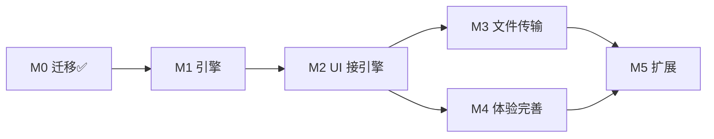

# 飞联 LANChat — 任务总索引（INDEX.md）

> **全部任务的唯一入口**：进度仪表盘 + 全任务清单 + 依赖图。
> 状态图例：✅ 完成 ｜ 🔶 进行中 ｜ ⬜ 未开始（与《[飞联-开发任务拆解.md](../飞联-开发任务拆解.md)》及各任务清单一致，变更时同步更新）。
> 开发任务请配合项目技能 `feilian-dev`（`.agents/skills/feilian-dev/`）使用：领取 → 实现 → 验收 → 回写状态。

## 1. 进度仪表盘

| 里程碑 | 内容 | 状态 | 执行清单 |
|---|---|---|---|
| M0 | 迁移与工程化（Wails 骨架 + React 前端迁移 + 协议 Go 实现 + 首个 exe） | ✅ 2026-10-29 | 见[拆解文档](../飞联-开发任务拆解.md) M0 节 |
| M1 | 网络引擎（UDP 发现 + 文本消息 + 飞秋互通） | ⬜ **当前主线** | [M1-网络引擎.md](./M1-网络引擎.md) |
| M2 | UI 接引擎（mock 退场，双开 exe 全交互可用） | ⬜ | [M2-UI接引擎.md](./M2-UI接引擎.md) |
| M3 | 文件传输（TCP 2425 + 文件夹递归 + 进度卡片） | ⬜ | [M3-文件传输.md](./M3-文件传输.md) |
| M4 | 体验完善（截图/托盘/通知/热键/设置/记录存储） | ⬜ | [M4-体验完善.md](./M4-体验完善.md) |
| M5 | 扩展（远程协助/群聊协议/记录搜索/限速细化） | ⬜ 暂缓 | [M5-扩展.md](./M5-扩展.md) |

M3 与 M4 可并行；M1 是一切的前提。

## 2. 全任务索引

### M0 ✅ 迁移与工程化（明细见拆解文档 M0 节）

T-M0-1 Wails 工程骨架 ✅｜T-M0-2 React 前端迁移清洗 ✅｜T-M0-3 窗口控制接线 ✅｜T-M0-4 IPMsg 协议 Go 实现 ✅｜T-M0-5 引擎门面骨架 ✅｜T-M0-6 构建验证 ✅（2026-10-29 全部完成）

### M1 网络引擎 — [清单](./M1-网络引擎.md)

T-M1-1 ~ T-M1-6 已完成（2026-10-29 闲时自动推进）；T-M1-7 编码适配就绪，**真机飞秋互通验证待用户执行**。

| ID | 任务 | 依赖 | 状态 |
|---|---|---|---|
| [T-M1-1](./M1-网络引擎.md#T-M1-1) | UDP 监听与广播发送 | — | ✅ |
| [T-M1-2](./M1-网络引擎.md#T-M1-2) | 上线发现与心跳 | T-M1-1 | ✅ |
| [T-M1-3](./M1-网络引擎.md#T-M1-3) | 用户表与状态机 | T-M1-2 | ✅ |
| [T-M1-4](./M1-网络引擎.md#T-M1-4) | 文本消息收发 | T-M1-1 | ✅ |
| [T-M1-5](./M1-网络引擎.md#T-M1-5) | 事件桥到 UI | T-M1-3/4 | ✅ |
| [T-M1-6](./M1-网络引擎.md#T-M1-6) | CLI 联调模式 | T-M1-4 | ✅ |
| [T-M1-7](./M1-网络引擎.md#T-M1-7) | 飞秋互通验证 | T-M1-4 | 🔶 |

### M2 UI 接引擎 — [清单](./M2-UI接引擎.md)

| ID | 任务 | 依赖 | 状态 |
|---|---|---|---|
| [T-M2-1](./M2-UI接引擎.md#T-M2-1) | 数据层替换 | T-M1-5 | ✅ |
| [T-M2-2](./M2-UI接引擎.md#T-M2-2) | 事件订阅 | T-M1-5 | ✅ |
| [T-M2-3](./M2-UI接引擎.md#T-M2-3) | 会话状态真实化 | T-M2-2 | ✅ |
| [T-M2-4](./M2-UI接引擎.md#T-M2-4) | 发送链路 | T-M2-3 | ✅ |
| [T-M2-5](./M2-UI接引擎.md#T-M2-5) | 正在输入 | T-M1-4 | ✅ |
| [T-M2-6](./M2-UI接引擎.md#T-M2-6) | 我的资料与状态 | T-M1-3 | ✅ |
| [T-M2-7](./M2-UI接引擎.md#T-M2-7) | 广播会话 | T-M1-4 | ✅ |

### M3 文件传输 — [清单](./M3-文件传输.md)

| ID | 任务 | 依赖 | 状态 |
|---|---|---|---|
| [T-M3-1](./M3-文件传输.md#T-M3-1) | 文件消息协议 | M1 | ✅ |
| [T-M3-2](./M3-文件传输.md#T-M3-2) | TCP 传输通道 | T-M3-1 | ✅ |
| [T-M3-3](./M3-文件传输.md#T-M3-3) | 传输管理器 | T-M3-2 | ✅ |
| [T-M3-4](./M3-文件传输.md#T-M3-4) | 文件夹递归 | T-M3-2 | ✅ |
| [T-M3-5](./M3-文件传输.md#T-M3-5) | UI 与设置落地 | T-M3-3 | ✅ |
| [T-M3-6](./M3-文件传输.md#T-M3-6) | 断点续传（可选，默认不做） | — | ⬜ |

### M4 体验完善 — [清单](./M4-体验完善.md)

| ID | 任务 | 依赖 | 状态 |
|---|---|---|---|
| [T-M4-1](./M4-体验完善.md#T-M4-1) | 屏幕截图 | M2 | ⬜ |
| [T-M4-2](./M4-体验完善.md#T-M4-2) | 系统托盘 | M2 | ⬜ |
| [T-M4-3](./M4-体验完善.md#T-M4-3) | 系统通知 | M2 | ✅ |
| [T-M4-4](./M4-体验完善.md#T-M4-4) | 全局热键 | T-M4-1 | ⬜ |
| [T-M4-5](./M4-体验完善.md#T-M4-5) | 设置持久化 | M2 | ✅ |
| [T-M4-6](./M4-体验完善.md#T-M4-6) | 聊天记录存储（形态待拍板） | M2 | ✅ |

### M5 扩展（暂缓） — [清单](./M5-扩展.md)

| ID | 任务 | 依赖 | 状态 |
|---|---|---|---|
| [T-M5-1](./M5-扩展.md#T-M5-1) | 远程协助 | M3 + M4 | ⬜ |
| [T-M5-2](./M5-扩展.md#T-M5-2) | 群聊协议（形态待拍板） | M2 | ⬜ |
| [T-M5-3](./M5-扩展.md#T-M5-3) | 聊天记录搜索 | T-M4-6 | ⬜ |
| [T-M5-4](./M5-扩展.md#T-M5-4) | 传输限速细化 | T-M3-2 | ⬜ |

## 3. 依赖关系

M1 内部建议顺序：T-M1-1 → 2 → 3 → 4 →（5/6/7 可穿插）。

## 4. 如何使用本索引

1. **领任务**：选「状态 ⬜ 且依赖全部 ✅」的最靠前任务（或用户指定 ID），点击 ID 跳到清单小节。
2. **开发**：按任务清单的子步骤与落点文件实现；架构约束见 [飞联-架构设计.md](../飞联-架构设计.md) §3，UI 规范见 [DESIGN.md](../../DESIGN.md)，协作规范见 [AGENTS.md](../../AGENTS.md)。
3. **验收**：对照清单「验收」行逐条核对（含测试命令）。
4. **回写**：勾选清单 checkbox；状态在三处同步——本索引任务行、任务清单标题、拆解文档总表。

## 5. 文档导航

| 文档 | 内容 |
|---|---|
| [飞联-需求文档.md](../飞联-需求文档.md) | 做什么：功能需求 / 协议 / 里程碑 / 待定问题 §8 |
| [DESIGN.md](../../DESIGN.md)（根目录） | 长什么样：UI 设计规范（令牌 / 组件 / 交互状态 / 验收清单） |
| [飞联-架构设计.md](../飞联-架构设计.md) | 怎么设计：分层架构 / 协议 / 数据流 / 坑位记录 |
| [飞联-开发任务拆解.md](../飞联-开发任务拆解.md) | 任务总表（M0–M5 要点与验收标准） |
| [AGENTS.md](../../AGENTS.md) | 协作指南：命令 / 环境备忘 / 架构铁律 / 工作约定 |

**待定问题**（动手对应任务前先拍板，见需求文档 §8）：① 飞秋互通深度 ② 聊天记录存储形态（T-M4-6 前必须定）③ 群聊形态 ④ 断点续传是否进 M3（默认不进）。
