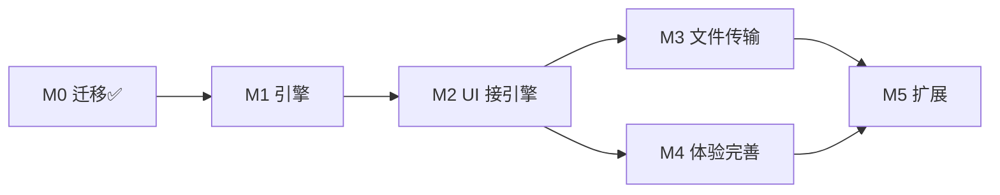

# 飞联 LANChat — 开发任务拆解

> 本文把《[飞联-需求文档.md](./飞联-需求文档.md)》的里程碑（M1–M5）拆成可执行、可验收的任务。
> UI 规范见根目录《[DESIGN.md](../DESIGN.md)》。
> 各里程碑的可勾选执行清单见 [tasks/](./tasks/)：[M1](./tasks/M1-网络引擎.md)｜[M2](./tasks/M2-UI接引擎.md)｜[M3](./tasks/M3-文件传输.md)｜[M4](./tasks/M4-体验完善.md)｜[M5](./tasks/M5-扩展.md)。
>
> **任务状态**：✅ 完成 ｜ 🔶 进行中 ｜ ⬜ 未开始
> **当前进度**：M0 已完成（代码迁移 + 工程化 + 首个 exe），M1 未启动。
> **总索引**（进度仪表盘 + 全任务清单）：[tasks/INDEX.md](./tasks/INDEX.md)。

## M0 迁移与工程化 ✅（2026-10-29 完成）

把 Gemini 产出的 React 原型（`D:\Code\React\lanchat`）迁移为 Wails 工程的正式前端。

| 任务 | 状态 | 说明 |
|---|---|---|
| T-M0-1 Wails 工程骨架 | ✅ | `main.go`（无框窗口 1180×720）+ `app.go`（窗口控制绑定）+ `wails.json` + `go.mod` |
| T-M0-2 React 前端迁移清洗 | ✅ | `frontend/src/` 全量迁入；剔除 @google/genai / express / dotenv / AI Studio 工件（.aistudio、public/assets、metadata.json） |
| T-M0-3 窗口控制接线 | ✅ | `frontend/src/lib/wailsBridge.ts` 桥接层（浏览器预览优雅降级）；TitleBar 最小化/最大化/关闭接 `window.go.main.App`，标题栏 `--wails-draggable` 可拖动；桌面形态全出血布局 |
| T-M0-4 IPMsg 协议 Go 实现 | ✅ | `engine/protocol.go`（命令码/选项位/编解码/飞联扩展码）+ 5 项单测全过 |
| T-M0-5 引擎门面骨架 | ✅ | `engine/engine.go`（Config/Peer/Event/Engine，TODO 挂到对应 M1 任务） |
| T-M0-6 构建验证 | ✅ | `wails build` 产出 `build/bin/feilian.exe`（11.6MB 单文件），冒烟启动通过（WebView2 环境正常） |

**开发环境备忘**：Go 1.26.3（GOBIN 在 mise 目录）、Wails CLI v2.17.0、Node 22 + npm；Go 拉包需 `GOPROXY=https://goproxy.cn,direct`（默认代理不可达）。日常开发：`wails dev` 热重载；发布：`wails build`。

## M1 网络引擎（当前主线）

目标：两台进程互相发现、互发文本消息，并与飞秋文本互通。全部在 `engine/` 包内，不碰 UI。

| ID | 任务 | 要点 | 验收标准 | 状态 | 依赖 |
|---|---|---|---|---|---|
| T-M1-1 | UDP 监听与广播发送 | **Windows 必须用 `net.ListenConfig` 的 Control 回调设置 `syscall.SO_BROADCAST`**，绑定 UDP 2425；支持广播地址 WriteTo | 单元测试：本机两个 UDP 套接字经广播地址互收报文 | ✅ | — |
| T-M1-2 | 上线发现与心跳 | 启动广播 `CmdBrEntry`（extra 携带 JSON：部门/状态）；收到 Entry 单播回 `CmdAnsEntry`；每 30s 心跳 `CmdNoOperation`；`CmdBrExit` 下线 | A 启动后 B 的 peers 列表出现 A，A 退出后 5s 内 B 侧下线 | ✅ | T-M1-1 |
| T-M1-3 | 用户表与状态机 | peers map + RWMutex；超时判定（离线）；`CmdBrAbsence` 状态变更（在线/勿扰/离开）映射 Peer.Status | `Peers()` 快照含昵称/IP/主机名/部门/状态；状态变更事件可推送 | ✅ | T-M1-2 |
| T-M1-4 | 文本消息收发 | `SendText` 直发 `CmdSendMsg\|OptSendCheck`；收到即回 `CmdRecvMsg`（回执按 PacketNo 关联）；广播消息走 `BroadcastText`；Extra 中文 UTF-8 验证 | 双进程互发消息秒达；回执事件触发；对飞秋发消息对方能收到 | ✅ | T-M1-1 |
| T-M1-5 | 事件桥到 UI | `app.go`：startup 起 goroutine 把 `engine.Events()` 转发为 Wails Events（`EventsEmit`）；绑定 `GetPeers/SendText/GetSelf/SetSelf` | 前端能订阅到 `peer_online`/`message` 事件（可先用日志页验证） | ✅ | T-M1-3/4 |
| T-M1-6 | CLI 联调模式 | `cmd/feilian-cli/`：不起 UI，终端打印事件 + stdin 发消息（`go run ./cmd/feilian-cli -nick 测试A`） | 两个终端窗口互发现、互发消息，作为引擎回归测试工具 | ✅ | T-M1-4 |
| T-M1-7 | 飞秋互通验证 | 真机装飞秋与本程序对发文本；核对编码（飞秋可能 GBK，需探测转换）、Entry/AnsEntry 兼容 | 与飞秋双向文本互通；不互通时输出差异分析记录 | 🔶 | T-M1-4 |

**M1 风险**：① 飞秋报文编码可能是 GBK 而非 UTF-8，需按首包探测；② 多网卡环境广播地址选择（枚举网卡取各网段定向广播，不能只发 255.255.255.255）；③ 防火墙首次运行需放行 UDP 2425（安装器/首启引导处理）。

## M2 UI 接引擎

目标：把 UI 从 mock 数据切到真实引擎事件，双开 exe 即可用原型里的全部交互。

| ID | 任务 | 要点 | 验收标准 | 状态 | 依赖 |
|---|---|---|---|---|---|
| T-M2-1 | 数据层替换 | `mockData.ts` 退化为「我自己」的初始值；contacts/conversations 由引擎事件驱动构建 | UI 无 mock 依赖，空网络时显示空态 | ✅ | T-M1-5 |
| T-M2-2 | 事件订阅 | 封装 `useEngineEvents`（Wails `EventsOn` → React state）：peer_online/offline/update、message、receipt、typing | 上线/下线实时反映在联系人与会话列表 | ✅ | T-M1-5 |
| T-M2-3 | 会话状态真实化 | 保留 `chatLogic.ts`（置顶/未读计算已有单测）；删除自动回复模拟 | 新消息 → 未读+置顶+预览更新；打开会话清零 | ✅ | T-M2-2 |
| T-M2-4 | 发送链路 | `handleSendMessage` → `SendText`；回执更新消息状态；失败（离线）行内提示 | 双开互发消息全链路 OK | ✅ | T-M2-3 |
| T-M2-5 | 正在输入 | 输入框停顿 500ms 发 `CmdFeiLinkTyping`；对端展示三点动画 | 双开可见 typing 指示 | ✅ | T-M1-4 |
| T-M2-6 | 我的资料与状态 | `UserProfileModal` → `SetSelf`（昵称/部门/状态）变更即广播 `CmdBrAbsence` | A 改状态，B 侧徽标/资料即时变化 | ✅ | T-M1-3 |
| T-M2-7 | 广播会话 | 联系人列表「局域网广播」→ `BroadcastText`；广播消息按来源人显示 | 广播全员可见 | ✅ | T-M1-4 |

**M2 验收** = 《[DESIGN.md](../DESIGN.md)》验收清单在真实双开环境下全部通过。

## M3 文件传输

| ID | 任务 | 要点 | 验收标准 | 状态 | 依赖 |
|---|---|---|---|---|---|
| T-M3-1 | 文件消息协议 | `CmdSendMsg\|OptFileAttach`，Extra 为文件列表（IPMsg 0x0011 扩展格式：fileID:名字:大小:属性），支持飞联扩展字段（目录树） | 与飞鸽官方格式字段对齐，单测覆盖 | ✅ | M1 |
| T-M3-2 | TCP 传输通道 | 监听 TCP 2425；接受后按块（默认 64KB）拉取；飞联间协商并发多块 | 1GB 文件传输成功、限速可生效 | ✅ | T-M3-1 |
| T-M3-3 | 传输管理器 | 任务表（进度/速度/取消/完成事件）；重复文件名落盘策略 | UI 传输卡片两种状态真实刷新 | ✅ | T-M3-2 |
| T-M3-4 | 文件夹递归 | 发送侧递归展开目录树，接收侧按树重建 | 传多层嵌套文件夹结构完整 | ✅ | T-M3-2 |
| T-M3-5 | UI 与设置落地 | 聊天头「发文件/发文件夹」真实选盘（Wails runtime dialog）；「接收目录/自动打开」设置生效 | 全流程可点通 | ⬜ | T-M3-3 |
| T-M3-6 | （可选）断点续传 | 待定问题 §8-4，默认不做 | — | ⬜ | — |

## M4 体验完善

| ID | 任务 | 要点 | 状态 | 依赖 |
|---|---|---|---|---|
| T-M4-1 | 屏幕截图 | Go 侧 `kbinani/screenshot` 取屏 + 选区窗口，替换 `ScreenshotModal` 的 canvas 模拟；产物直接进发送链路（图片消息 + M3 文件） | ⬜ | M2 |
| T-M4-2 | 系统托盘 | `getlantern/systray`：常驻、未读角标、恢复/退出菜单；关闭按钮进托盘（设置可选「退出」） | ⬜ | M2 |
| T-M4-3 | 系统通知 | `beeep`；勿扰状态只累计不弹 | ⬜ | M2 |
| T-M4-4 | 全局热键 | `golang.design/x/hotkey` 注册 Ctrl+Alt+A / Ctrl+F | ⬜ | T-M4-1 |
| T-M4-5 | 设置持久化 | JSON 配置（%APPDATA%/feilian/config.json）：昵称/部门/主题/接收目录/热键/开机自启动 | ⬜ | M2 |
| T-M4-6 | 聊天记录存储 | 待定问题 §8-2（JSON 按日落盘 vs SQLite）；会话内滚动加载历史 | ⬜ | M2 |

## M5 扩展（暂缓）

T-M5-1 远程协助（屏幕流 + 指令转发，`RemoteAssistModal` 已有 UI 骨架）｜T-M5-2 群聊协议（`CmdFeiLinkGroupMsg` 分发与聚合）｜T-M5-3 聊天记录搜索｜T-M5-4 传输限速细化。

## 依赖关系

M3 与 M4 可并行推进；M1 是一切的前提，建议顺序：T-M1-1 → 2 → 3 → 4 →（5/6/7 可穿插）。

## 待定问题（承接需求文档 §8，开工 M1 前拍板）

1. **飞秋互通优先级** → 影响 T-M1-7 的深度与 GBK 转换投入。
2. **聊天记录存储形态** → T-M4-6 前必须定。
3. **群聊形态**（本地分组即可 or 邀请/退群）→ 影响 T-M5-2。
4. **断点续传是否进 M3** → 默认不进。
